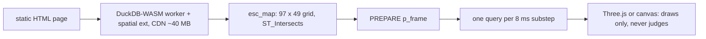

# watchduck

**A mechanical watch escapement that runs inside DuckDB-WASM, in your browser. No server, no physics engine — every tick is a SQL query.**

[Chinese version: README_cn.md](README_cn.md)

Inspired by [“The Watchmaker: Building a Mechanical Watch in a Database”](https://sqlartist.github.io/posts/the-watchmaker-building-a-mechanical-watch-in-a-database/) (which used SQL Server Spatial, then PostGIS) and Bartosz Ciechanowski's [Mechanical Watch](https://ciechanow.ski/mechanical-watch/).

## Quick start

No build step, no backend, no dependencies to install — the site is plain static HTML:

```sh
git clone https://github.com/alitrack/watchduck
cd watchduck
python3 -m http.server 8000
# open http://localhost:8000
```

The first load of the demo pages downloads the ~40 MB DuckDB-WASM engine + `spatial` extension from a public CDN (jsDelivr); it is cached by the browser afterwards, so later loads are instant and work offline. The hub page (`index.html`) itself has no engine and loads instantly.

## What you see

A 15-tooth escape wheel, a pallet fork with two stones, and a balance wheel. The fork swings ±10° at 5 beats/second (18,000 bph, a classic movement rate). The wheel creeps forward half a tooth pitch per beat — **about 12° per beat — and nothing in the code ever says 12**. That number falls out of the shapes, exactly like in a real Swiss lever escapement.

## How it works — model the metal, not the maths

Every part is a polygon. The database is asked exactly one physical question, over and over:

```sql
SELECT ST_Intersects(
  ST_Rotate(tooth, wheel_angle),
  ST_Rotate(stone, fork_angle)
);
```

1. **Build the map (once, in SQL).** DuckDB-WASM loads the `spatial` extension, then cross-joins a 97 × 49 grid of wheel phases × fork angles — 4,753 states, 2 `ST_Intersects` per state (~9,500 calls total) — into an `esc_map` table. This is the watch's entire physics, precomputed by the database.
2. **Run the watch (per frame, in SQL).** Each animation frame positions the fork with a triangle wave (like a real balance dwelling at the turn points) and asks the database one prepared query (`p_frame`): *is this state blocked?* If free, the wheel advances; if blocked, the metal stops it. Lock → release → lock → release: the tick.
3. **Draw (Three.js / canvas).** The browser only draws what DuckDB decided. It never decides anything.

The 3D view is pure presentation — the same DuckDB collision map and one-query-per-substep solver drive it, so the 3D and 2D views never disagree. Press **“Show collision map”** to see the actual table: red = metal on metal, green = the wheel may pass. The horizontal free corridor shifting with fork angle **is** the escapement.

## Architecture

One static page, one wasm worker, one database. The renderer is downstream of the SQL and has no decision power:



## Demo entries

The hub page ([**live: alitrack.github.io/watchduck**](https://alitrack.github.io/watchduck/)) offers four CTAs:

- **Run Live SQL Simulation →** opens `escapement3d.html` — the 3-part escapement in 3D, ticking in real time.
- **Break the Watch →** opens the same page with the experiment card open (`#experiment`): one real geometric parameter, rebuilt live in SQL (below).
- **Take the story · 90 s →** runs a 4-step guided tour on the 3D page (`#story`): model the metal → ask SQL → observe the tick → break & recover. It only points at the live demo — it adds no second engine.
- **View the SQL →** opens [`04_take_apart.sql`](04_take_apart.sql), the disassembly predicates exactly as the database executes them.

Three demo pages, one engine:

- **[index34.html — Ep5 full movement (34 parts / 107 pieces)](https://alitrack.github.io/watchduck/index34.html)** — the complete calibre in 3D, with the **take-apart running live in DuckDB-WASM**: the disassembly loop (`m_blocked()`, one SQL per part per round) peels 8 rounds in the browser, matching the golden table of the [watchmaker-sql Ep5 reference](https://github.com/sqlartist/watchmaker-sql). Geometry is a pre-solved 868 KB snapshot (phases baked in) because the wasm engine's ~256 MB linear memory can't build 107 macro-generated pieces live — but every take-apart verdict is still a query the browser's database makes. See [`ep5_movement/`](ep5_movement/) for the SQL port + snapshot generator.
- **[escapement3d.html — 3-part escapement, 3D](https://alitrack.github.io/watchduck/escapement3d.html)** — Three.js rendering, solid metal escape wheel + ruby stones + balance, real-time ticking; the 97 × 49 collision map (~9,500 `ST_Intersects`) is built live and walked tick by tick by a prepared SQL solver.
- **[index2d.html — 2D engineering view](https://alitrack.github.io/watchduck/index2d.html)** — same engine, orthographic outlines, collision states marked on the drawing.

Each page is a self-contained static HTML (no build, no backend):

- ~40 MB DuckDB-WASM + spatial extension downloads on first load (cached after), works offline afterwards
- **Start / Pause / Reset**, and the live counter of the emergent **deg/beat** (theory: 12.00° = half the 24° tooth pitch)

## Break the Watch

The experiment card on the 3D page moves exactly **one real geometric parameter**: the entry pallet stone, shifted along its long axis, in millimetres (slider range −0.8…+0.8 mm, step 0.05). Committing a value does not animate anything by hand — it runs, in the browser's DuckDB:

1. regenerates the entry stone's WKT (and re-derives its 3D mesh from the same number);
2. `CREATE OR REPLACE TABLE esc_map` — the 97 × 49 grid rebuilt with the new geometry (2 `ST_Intersects` per state);
3. re-`PREPARE`s `p_frame` with the new WKT;
4. resets the motion so the watch restarts against the new map.

Fault labels are **gated on real data, never synthesized**: “Stalled by SQL solver” appears only after N = 40 consecutive substeps with no wheel advance; “Lock lost (free run)” only while the rebuilt map reports zero blocked states at fork = 0.

Measured parameter scan (number of blocked states out of the 4,753 in the rebuilt `esc_map`):

| entry-stone offset (mm) | blocked states |
| --- | --- |
| −0.40 | 1,801 |
| −0.30 | 1,723 |
| −0.20 | 1,638 |
| 0.00 (frozen baseline) | 1,438 |
| +0.10 | 1,324 |
| +0.20 | 1,197 |
| +0.30 | 1,070 |
| +0.40 | 937 |

Beyond the measured range: at ≤ −0.55 mm the map grows dead wheel-phase columns and the solver stalls; at ≥ +0.45 mm lock at fork 0 is 0 and the wheel free-runs. Both faults are properties of the rebuilt collision map — not an animation.

## Known limitations

- The 3D escapement view is a **2D cross-section collision model rendered in 3D** — the same `esc_map` / `p_frame` SQL as the 2D view. It is not a mechanics/dynamics solver: no mass, torque or integration.
- `esc_map` uses a **single representative tooth** (the wheel is periodic in 24° phase, so one tooth per phase column suffices). At the frozen baseline the exit-stone term yields 0 hits in the map — all blocking comes from the entry stone.
- The 34-part page uses an **offline geometry snapshot** (868 KB, phases baked in) + a **live in-browser take-apart SQL loop** — the disassembly verdicts are real queries, the geometry is not rebuilt live.
- Mobile: **collapsible-layout adaptation only** (panels fold at ~390 px); no touch-specific interactions beyond that.
- The balance wheel is drawn but its inertia is not simulated — the fork follows a prescribed 5 Hz triangle wave (a real balance's phase emerges from impulse; that's future work).
- Wheel motion while free is constant-speed, not torque-driven.
- Teeth are convex quadrilaterals, not epicycloid profiles.
- **Browser support:** verified on Chromium (desktop and headless, incl. the E2E below). Firefox and Safari have not been systematically tested.

## Verification & regression

- `python3 scripts/geometry.py` — re-checks the frozen part dimensions against the geometric acceptance criteria (lock at center swing, ~half-pitch release at extreme swing, zero dead zones). Expect `ACCEPTANCE: PASS` (last verified: LOCK 0.78, release −10°→11.2 / +10°→10.8, dead zones 0). `--search` reruns the random search.
- `node scripts/e2e.mjs --check` — static assertions on a clean checkout: required files exist, key strings present (`esc_map`, `p_frame`, `ST_Intersects`, `ST_Rotate`, `m_blocked`, the boot-state machine), expected HTML element ids in the demo pages, and a syntax check of the script itself. No browser, no network — exit 0/1.
- `node scripts/e2e.mjs --browser` — full Playwright E2E against `escapement3d.html` (served locally): load until ready (≤ 120 s, ~40 MB wasm on first hit of the CDN) → Start → beats > 0 → Pause → trace verdict chip consistent with the last real `p_frame` result → slider to −0.30 mm and rebuild → collision-map counter shows 1,723 blocked → Reset → 1,438 → experiment card opens/closes → zero uncaught page errors. Exit 0/1; exit 2 with install guidance if Playwright or its chromium is missing.

Clean-checkout walkthrough:

```sh
git clone https://github.com/alitrack/watchduck && cd watchduck
python3 scripts/geometry.py            # golden geometry: expect ACCEPTANCE: PASS
node scripts/e2e.mjs --check           # static regression: expect exit 0
python3 -m http.server 8000            # browse the site (or: npm install && npx playwright install chromium, then: node scripts/e2e.mjs --browser)
```

## Repo layout

```
index.html              hub page — four CTAs across the demos (no engine, instant load)
escapement3d.html       the 3-part escapement app, 3D (static, no build step)
index2d.html            the 3-part escapement, 2D engineering view
index34.html            the 34-part full movement + live wasm take-apart
movement_snapshot.json  assembled Ep5 state (world WKT per piece, phases baked in)
04_take_apart.sql       the m_blocked take-apart engine (runs in both native + wasm)
earcut.min.js           vendored earcut (index34 triangulates WKT profiles with it)
ep5_movement/           the native DuckDB port of the reference (SQL + drivers)
scripts/geometry.py     frozen part dimensions + the random search that found them
scripts/e2e.mjs         regression: --check (static) / --browser (Playwright E2E)
docs/showcase/          campaign docs: baseline, QA, browser-console E2E
assets/                 page images (preview poster)
```

## Why DuckDB (and why not something else)

The original article had to flee SQL Server 2025 for PostGIS because SQL Server has no `ST_Rotate` — the author's fastest rotate was string-editing WKT text. DuckDB's `spatial` extension ships rotation, translation and intersection out of the box, vectorized. The map build (~9.5k intersects) takes a few hundred milliseconds in WASM. SQLite could do this with a hand-written SAT query in pure SQL (we verified — it works, ~300× slower), and PostGIS remains the right tool for the article's eventual 3D keyless works — but for the 2D escapement, DuckDB-in-a-browser is enough. All the way down.

## License

MIT — see [LICENSE](LICENSE).
