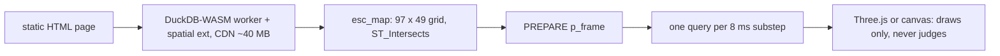

# watchduck

**在浏览器里用 DuckDB-WASM 跑的机械表擒纵机构。没有服务器、没有物理引擎——每一拍都是一条 SQL 查询。**

[English README](README.md)

灵感来自[《The Watchmaker: 用数据库造一块机械表》](https://sqlartist.github.io/posts/the-watchmaker-building-a-mechanical-watch-in-a-database/)（原作者先用 SQL Server Spatial，后迁 PostGIS）以及 Bartosz Ciechanowski 的 [Mechanical Watch](https://ciechanow.ski/mechanical-watch/)。

## 快速启动

无构建步骤、无后端、无需安装任何依赖——站点就是纯静态 HTML：

```sh
git clone https://github.com/alitrack/watchduck
cd watchduck
python3 -m http.server 8000
# 打开 http://localhost:8000
```

演示页首次加载会从公共 CDN（jsDelivr）下载约 40 MB 的 DuckDB-WASM 引擎 + `spatial` 扩展，浏览器会缓存，之后秒开、离线可用。首页（`index.html`）本身不带引擎，打开即用。

## 你会看到什么

一个 15 齿的擒纵轮、带两颗宝石的擒纵叉、一个摆轮。擒纵叉以 5 拍/秒（18000 bph，经典机芯频率）摆动 ±10°。擒纵轮每拍前进半个齿距——**约 12°/拍，而代码里从没写过 12 这个数字**。它和真表一样，是从形状里「涌现」出来的。

## 原理——建模金属，不建数学

每个零件都是多边形。数据库只被问一个物理问题，反复问：

```sql
SELECT ST_Intersects(
  ST_Rotate(tooth, wheel_angle),
  ST_Rotate(stone, fork_angle)
);
```

1. **建碰撞图（一次性，SQL 完成）。** DuckDB-WASM 加载 `spatial` 扩展后，把 97 × 49 的「轮相位 × 叉角」网格 cross join——4,753 个状态，每状态 2 次 `ST_Intersects`（合计约 9,500 次）——写入 `esc_map` 表。这就是这块表的全部物理，由数据库预计算。
2. **跑表（每帧一条 SQL）。** 每个动画帧用三角波定位叉（像真摆轮在转折点有驻留），向数据库发一条 prepared query（`p_frame`）：*这个状态被卡住吗？* 空闲则轮前进，卡住则金属挡停。锁 → 放 → 锁 → 放：滴答。
3. **画（Three.js / canvas）。** 浏览器只画 DuckDB 决定好的结果，自己从不做决定。

3D 视图是纯展示层——同一个 DuckDB 碰撞表、同一套每子步一查的求解器在驱动，所以 3D 和 2D 视图永不矛盾。点 **“Show collision map”** 能看到真实的表：红 = 金属碰金属，绿 = 轮可通行。那条随叉角平移的水平自由走廊，**就是**擒纵机构。

## 架构

一个静态页、一个 wasm worker、一个数据库。渲染器位于 SQL 下游，没有任何决策权：



## 演示入口

首页（[**在线：alitrack.github.io/watchduck**](https://alitrack.github.io/watchduck/)）提供四个 CTA：

- **Run Live SQL Simulation →**：打开 `escapement3d.html`——3 零件擒纵组 3D 视图，实时走针。
- **Break the Watch →**：打开同一页面并展开实验卡（`#experiment`）：一个真实的几何参数，在 SQL 里现场重建（见下节）。
- **Take the story · 90 s →**：在 3D 页上跑 4 步导览（`#story`）：建模金属 → 问 SQL → 看滴答 → 打破与恢复。它只指向活的演示，不引入第二套引擎。
- **View the SQL →**：打开 [`04_take_apart.sql`](04_take_apart.sql)，即数据库实际执行的拆卸谓词原文。

三个演示页，同一套引擎：

- **[index34.html — Ep5 全机芯（34 零件 / 107 件）](https://alitrack.github.io/watchduck/index34.html)**——完整机芯 3D，拆卸循环 `m_blocked()`（每轮每零件一条 SQL）直接在浏览器 DuckDB-WASM 里跑 8 轮，复现 [watchmaker-sql Ep5 参考](https://github.com/sqlartist/watchmaker-sql)的黄金表。几何是 868 KB 预求解快照（相位烘焙在内，wasm 单线程 ~256 MB 线性内存装不下 107 件现场宏生成），但每条拆卸判决仍是浏览器里的一条 SQL。SQL 移植 + 快照生成器见 [`ep5_movement/`](ep5_movement/)。
- **[escapement3d.html — 3 零件擒纵组 · 3D](https://alitrack.github.io/watchduck/escapement3d.html)**——Three.js 渲染：立体金属擒纵轮 + 红宝石叉石 + 摆轮，实时走针；97 × 49 碰撞表（约 9,500 次 `ST_Intersects`）现场建立，prepared SQL 求解器逐 tick 行走。
- **[index2d.html — 2D 工程视图](https://alitrack.github.io/watchduck/index2d.html)**——同一引擎，正交轮廓，碰撞态在图上标出。

每个页面都是自包含静态 HTML（无构建、无后端）：

- 首次加载下载约 40 MB 的 DuckDB-WASM + spatial 扩展（之后缓存），离线可用
- **Start / Pause / Reset**，以及实时计数的涌现 **deg/beat**（理论值：12.00° = 24° 齿距的一半）

## Break the Watch（打破这块表）

3D 页上的实验卡只动**一个真实几何参数**：入口叉石（entry pallet stone）沿其长轴偏移，单位毫米（滑杆范围 −0.8…+0.8 mm，步长 0.05）。提交一个值不会靠动画假装——它在浏览器的 DuckDB 里依次执行：

1. 重新生成入口叉石的 WKT（3D 网格也从同一个数字推导）；
2. `CREATE OR REPLACE TABLE esc_map`——用新几何重建 97 × 49 网格（每状态 2 次 `ST_Intersects`）；
3. 用新 WKT 重新 `PREPARE p_frame`；
4. 重置运动，让表对着新地图重新开跑。

故障标签**严格门控于真实数据，从不合成**：「Stalled by SQL solver」只在连续 N = 40 个子步无轮推进后出现；「Lock lost (free run)」只在重建后的地图报告叉角 = 0 时阻塞数为 0 期间出现。

实测参数扫描（重建后 `esc_map` 中 4,753 个状态的 blocked 数）：

| 入口叉石偏移 (mm) | blocked 状态数 |
| --- | --- |
| −0.40 | 1,801 |
| −0.30 | 1,723 |
| −0.20 | 1,638 |
| 0.00（冻结基线） | 1,438 |
| +0.10 | 1,324 |
| +0.20 | 1,197 |
| +0.30 | 1,070 |
| +0.40 | 937 |

超出实测区间：≤ −0.55 mm 时地图出现死相位列，求解器停摆；≥ +0.45 mm 时叉角 0 处锁率为 0，轮自由飞转。两种故障都是重建后碰撞图本身的性质——不是动画。

## 已知限制

- 3D 擒纵视图是**二维截面碰撞模型的 3D 展示**——与 2D 视图共用同一套 `esc_map` / `p_frame` SQL。它不是力学/动力学求解器：没有质量、扭矩、积分。
- `esc_map` 采用**单代表齿建模**（轮在 24° 相位上周期重复，每相位一列一个齿即够）。冻结基线下 exit 叉石项在地图中 0 命中——全部阻塞来自 entry 叉石。
- 34 零件页使用**离线几何快照**（868 KB，相位烘焙）+ **浏览器内实时拆卸 SQL 循环**——拆卸判决是真查询，几何不现场重建。
- 移动端：仅**折叠布局适配**（约 390 px 下面板收起），无额外的触控交互。
- 摆轮只画了，没仿真惯性——叉按 5 Hz 三角波走（真实摆轮的相位由冲量涌现，属后续工作）。
- 释放期间轮是匀速，不是力矩驱动。
- 齿形是凸四边形，不是摆线齿形。
- **浏览器兼容**：Chromium（桌面与 headless，含下述 E2E）已验证；Firefox 与 Safari 未系统测试。

## 验证与回归

- `python3 scripts/geometry.py`——复验冻结零件尺寸是否仍满足几何验收标准（中位摆角锁死、极端摆角放行约半齿距、零死区）。期望 `ACCEPTANCE: PASS`（最近一次实测：LOCK 0.78，release −10°→11.2 / +10°→10.8，dead zones 0）。`--search` 重跑随机搜索。
- `node scripts/e2e.mjs --check`——干净检出的静态断言：必需文件存在、关键字符串在位（`esc_map`、`p_frame`、`ST_Intersects`、`ST_Rotate`、`m_blocked`、加载状态机）、演示页应有的 HTML 元素 id、脚本自身语法检查。无需浏览器、无需网络，exit 0/1。
- `node scripts/e2e.mjs --browser`——对 `escapement3d.html` 的完整 Playwright E2E（本地起静态服务）：加载至 ready（≤ 120 s，首次命中 CDN 约 40 MB wasm）→ Start → beats > 0 → Pause → Trace 判语 chip 与最近一次真实 `p_frame` 结果一致 → 滑杆到 −0.30 mm 重建 → 碰撞表计数显示 1,723 blocked → Reset → 1,438 → 实验卡可开可关 → 无未捕获 pageerror。exit 0/1；缺 Playwright 或缺 chromium 时打印安装指引并 exit 2。

干净检出操作：

```sh
git clone https://github.com/alitrack/watchduck && cd watchduck
python3 scripts/geometry.py            # 黄金几何：期望 ACCEPTANCE: PASS
node scripts/e2e.mjs --check           # 静态回归：期望 exit 0
python3 -m http.server 8000            # 浏览站点（或：npm install && npx playwright install chromium，再跑：node scripts/e2e.mjs --browser）
```

## 仓库结构

```
index.html              首页——跨演示的四个 CTA（无引擎，秒开）
escapement3d.html       3 零件擒纵组 3D 应用（纯静态，无构建步骤）
index2d.html            3 零件擒纵组 2D 工程视图
index34.html            Ep5 34 零件全机芯 + 浏览器内 wasm 实时拆卸
movement_snapshot.json  Ep5 装配态快照（每件 world WKT，相位烘焙）
04_take_apart.sql       m_blocked 拆卸引擎（native + wasm 通用）
earcut.min.js           本地化的 earcut（index34 用它三角化 WKT 轮廓）
ep5_movement/           参考实现的 native DuckDB 移植（SQL + driver）
scripts/geometry.py     冻结的零件尺寸 + 找到这些尺寸的随机搜索
scripts/e2e.mjs         回归：--check（静态）/ --browser（Playwright E2E）
docs/showcase/          campaign 文档：baseline、QA、浏览器 console E2E
assets/                 页面图片（预览海报）
```

## 为什么是 DuckDB

原作者被 SQL Server 逼去 PostGIS，因为 SQL Server 连 `ST_Rotate` 都没有——最快的旋转办法是改写 WKT 字符串。DuckDB 的 `spatial` 扩展原生带旋转/平移/相交，向量化执行，建图（约 9,500 次相交判定）在 WASM 里几百毫秒完成。SQLite 用纯 SQL 手写 SAT 也能做（实测可行，慢约 300 倍）；文章后续的真 3D 部分仍是 PostGIS/SFCGAL 的主场——但 2D 擒纵机构，浏览器里的 DuckDB 就够了。

## 许可

MIT — 见 [LICENSE](LICENSE)。
